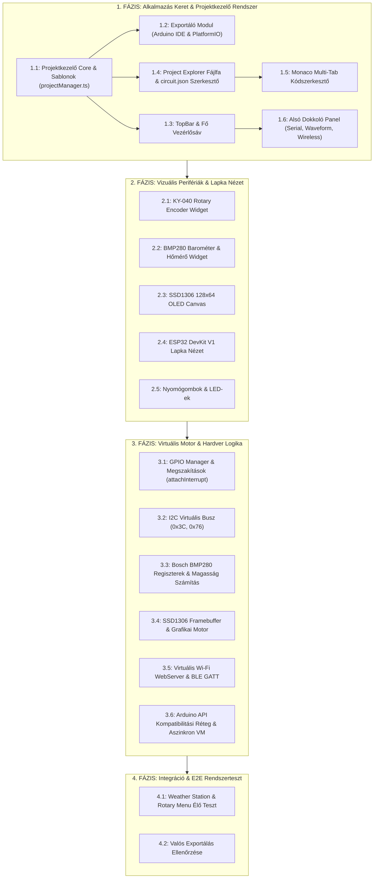

# AI & Fejlesztői Lépésről-Lépésre Megvalósítási Útmutató (IDE & Project-First Architecture)

> **Fejlesztési Sorrend:**
> 1. **Alkalmazás Keret & Projektkezelő Rendszer (IDE Shell, Fájlkezelés, Multi-Tab Monaco Editor, circuit.json).**
> 2. **Interaktív Vizuális Periféria Stúdió (Rotary Encoder, BMP280, OLED Canvas, DevKit Board).**
> 3. **Virtuális ESP32 Motor & Hardver Emuláció (GPIO, Megszakítások, I2C Busz, Arduino API, Wi-Fi/BLE).**
> 4. **Bekötés, Integráció & Exportálás (Arduino IDE & PlatformIO).**

---

## 🗺️ Részletes Lépések

---

## 🔬 1. FÁZIS Lépései (Projektkezelés & IDE Keret)

### Lépés 1.1: Projektkezelő Core & Sablonok (`src/project/`)
- `src/project/defaultProjects.ts`:
  - *Időjárásállomás & Rotary Menü* sablon (`main.ino`, `config.h`, `display_menu.cpp`, `circuit.json`).
  - *OLED Grafika és Animációk* sablon.
  - *Rotary Encoder Alapok* sablon.
  - *Üres ESP32 Vázlat*.
- `src/project/projectManager.ts`:
  - Projekt létrehozása, megnyitása, mentése, fájl hozzáadása (`addFile`), átnevezése (`renameFile`), törlése (`deleteFile`), aktív fül váltása (`setActiveFile`).
  - `circuit.json` periféria konfiguráció kezelése (`addPeripheral`, `removePeripheral`, `updatePeripheralPins`).
- **Önálló Teszt:** Projekt inicializálása, új fájl (`sensors.h`) hozzáadása, tartalom módosítása, törlése.

### Lépés 1.2: Exportáló Modul (`src/project/exporter.ts`)
- `exportToArduinoZip(project: ESPProject)`: Szabványos `.ino` vázlat mappa generálása.
- `exportToPlatformIOZip(project: ESPProject)`: `platformio.ini` és `src/` források csomagolása.
- **Önálló Teszt:** Exportálás futtatása és a kimeneti fájlok struktúrájának ellenőrzése.

### Lépés 1.3: TopBar & Fő Vezérlősáv (`src/components/TopBar.tsx`)
- Projekt neve és átnevezés, Új / Megnyitás / Mentés / Exportálás gombok.
- Futtatás vezérlők: Start, Pause, Step, Reset, Sebességválasztó (1x, 2x, 5x), Állapotjelző badge.

### Lépés 1.4: Project Explorer Fájlfa (`src/components/ProjectSidebar.tsx`)
- Fájlok listája ikonokkal (`.ino`, `.h`, `.cpp`, `.json`).
- Új fájl gomb, fájl törlése (kuka ikon), átnevezés.
- Csatlakoztatott perifériák gyors áttekintése és `circuit.json` konfigurátor modal.

### Lépés 1.5: Monaco Multi-Tab Kódszerkesztő (`src/components/EditorView.tsx`)
- Nyitott fájlok fülkéi (Tabs) bezárás (`x`) és váltás funkcióval.
- Monaco Editor beágyazása C++ / Arduino szintaxiskiemeléssel, automatikus kiegészítéssel és sorszámozással.

### Lépés 1.6: Alsó Dokkoló Panel (`src/components/BottomDock.tsx`)
- Fülek: **Serial Monitor**, **Logic Waveform (Analizátor)**, **Wireless (Web & BLE)**, **Lábkiosztás Diagnosztika**.
- Reszponzív, összecsukható és átméretezhető alsó felület.
