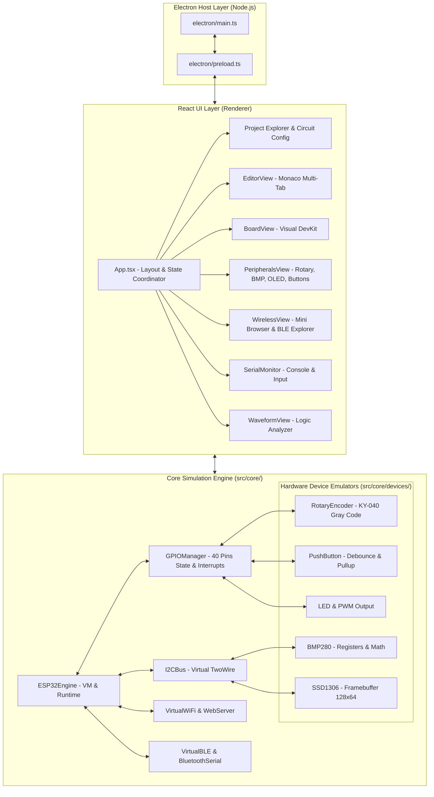

# Rendszer Architektúra (System Architecture)

Ez a dokumentum részletezi az **ESP32 Desktop Hardware Simulator** felépítését, az adatfolyamokat, a rétegek közötti kommunikációt, a vezeték nélküli alrendszereket (Wi-Fi, Bluetooth/BLE) és a projektkezelőt.

---

## 1. Rendszer Áttekintés

A szimulátor moduláris rétegekből áll:
1. **Electron Shell (Host Layer):** Natív asztali integráció, ablakkezelés, fájlrendszer-hozzáférés (mentés/megnyitás/exportálás).
2. **React UI Layer (Presentation & User Interaction):** Vizuális kezelőfelület (Monaco Multi-Tab Editor, Project Explorer, ESP32 Board, Perifériák, Virtuális Böngésző, BLE Explorer, Serial Monitor, Waveform).
3. **Core Simulation Engine (Virtual MCU, Bus & Wireless Layer):** Virtuális ESP32 processzor, GPIO állapotgép, I2C buszkezelő, Wi-Fi & WebServer mock, Bluetooth/BLE motor és Arduino API futtató környezet.

---

## 2. Részletes Modulok és Felelősségek

### A. Core Simulation Engine (`src/core/`)
- **`esp32Engine.ts`**: Fő futtató életciklus (`setup`, `loop`, `millis`, `micros`, `delay`), sebességvezérlés és hibakezelés.
- **`gpioManager.ts`**: 40 GPIO láb kezelése, analóg ADC (0-4095), PWM (0-255), élvezérelt megszakítások (`attachInterrupt`).
- **`i2cBus.ts`**: Kétvezetékes virtuális busz (SDA: 21, SCL: 22) `0x3C` (OLED) és `0x76` (BMP280) címekkel.
- **`virtualWifi.ts`**: Wi-Fi STA és SoftAP mód, beépített virtuális HTTP webszerver és MQTT kliens.
- **`virtualBle.ts`**: Bluetooth Classic Serial és BLE GATT szerver (Environmental Sensing Service UUID `0x181A`).

### B. Hardver Periféria Emulátorok (`src/core/devices/`)
- **`rotaryEncoder.ts`**: KY-040 kvadratúra Gray-kód generátor (CW/CCW) és nyomógomb (`SW`).
- **`bmp280.ts`**: Bosch I2C regisztertérkép (`0xD0`, `0xF4`, `0xF7..0xFC`), hőmérséklet, légnyomás és magasság számítás.
- **`ssd1306.ts`**: 128x64 monokróm OLED framebuffer, pixelrajzolás, alakzatok és 5x7 / 8x8 fontok.
- **`button.ts` & `led.ts`**: Prellmentesítés, felhúzás és állapotjelzés.

### C. Projektkezelő Rendszer (`src/project/`)
- **`projectManager.ts`**: Projekt életciklus, több fájl kezelése (`main.ino`, `.h`, `.cpp`), `circuit.json` áramköri konfiguráció, mentés és Arduino IDE / PlatformIO exportálás.

### D. UI Komponensek (`src/components/`)
- **`TopBar.tsx`**: Projekt név, Run/Pause/Reset, sebességválasztó, Export és Mentés gombok.
- **`ProjectSidebar.tsx`**: Projekt fájlfa, új fájl hozzáadása, perifériák listája.
- **`EditorView.tsx`**: Monaco kódszerkesztő több füllel (tabs) és C++ szintaxiskiemeléssel.
- **`BoardView.tsx`**: ESP32 DevKit lapka aktív lábakkal.
- **`Peripherals/`**: Rotary Encoder tárcsa, BMP280 csúszkák, OLED képernyő vászon, gombok.
- **`WirelessView.tsx`**: Virtuális böngésző tab a webszerverhez és BLE GATT explorer tab.
- **`SerialMonitor.tsx` & `WaveformView.tsx`**: Soros konzol és logikai analizátor.
