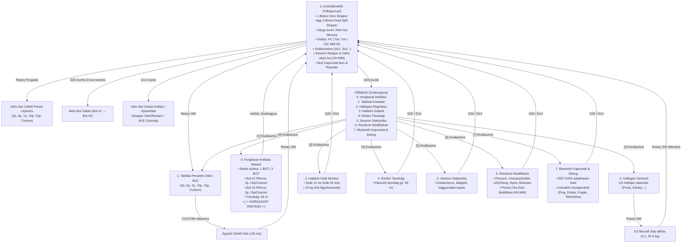

# FeederMate Menütérkép & Verseny-Optimalizálási Útmutató

> **Dokumentum verzió:** 2.3 (Interactive Session Wizard & Unified Rod Control Edition)  
> **Cél:** Átfogó menü- és képernyőtérkép, valamint versenyhorgászati UX optimalizálási javaslatok a leggyorsabb és legpontosabb kezeléshez éles match/feeder versenyhelyzetben.

---

## 🗺️ I. Részletes Menütérkép & Képernyő Állapotgép (Screen Flow)

---

## 🕹️ II. Hardveres Kezelőszervek Funkciótáblázata Képernyőnként

| Képernyő | D14 Gomb (DOBÁS / KO) | D26 Gomb (MENÜ) | D33 Gomb (BOTVÁLTÁS) | Rotary Forgatás (CW/CCW) | Rotary SW Gombnyomás |
| :--- | :--- | :--- | :--- | :--- | :--- |
| **0. Dashboard** | **Aktív Bot Dobás indítás** | Főmenü megnyitása | **Aktív Bot Váltás** *(2 botnál)* | Aktív bot célidő preset léptetés | Aktív bot Preset menü |
| **0. Session Wizard**| Visszalépés (Főmenü) | Kilépés a Dashboardra | — | Érték állítása / Mező léptetés | Mező szerkesztés / **INDÍTÁS** |
| **1. Főmenü** | Visszalépés (Dashboard) | Kilépés a Dashboardra | — | 8 Menüpont közötti görgetés | Belépés a kiválasztott menüpontba |
| **2. Preset Menü** | Visszalépés (Dashboard) | Kilépés a Dashboardra | — | Presetek választása (2p..15p, Custom) | Aktív bot célidő jóváhagyása |
| **3. Custom Dial** | Visszalépés | Kilépés a Dashboardra | — | Idő finomhangolás (±30 mp) | Egyedi idő mentése aktív botra |
| **4. Fogás Varázsló** | Mégse / Vissza | Kilépés a Dashboardra | — | 1/2 Halfajta / 2/2 Súly léptetés | Tovább / Végleges Mentés |
| **5. Száktartalom** | Visszalépés | Kilépés a Dashboardra | — | Szákok közötti váltás | Aktív szák kiválasztása |
| **6. Távolság Állító**| Visszalépés | Kilépés a Dashboardra | — | Távolság állítás (±1 m) | Távolság mentése |
| **7. Session Stat** | Visszalépés | Kilépés a Dashboardra | — | Statisztikák görgetése | — |
| **8. Beállítások** | Visszalépés | Kilépés a Dashboardra | — | Opciók görgetése (Fényerő, Botszám...) | Módosítás / Órabeállítás |
| **9. BLE Debug** | Visszalépés | Kilépés a Dashboardra | — | Tesztgombok közötti navigáció | Kiválasztott teszt küldése |
| **10. Kézi Óra (HH:MM)**| Visszalépés | Kilépés a Dashboardra | — | Óra / Perc növelése, csökkentése | Óra ➔ Perc ➔ Mentés |

---

## 🏆 III. Versenyhorgászati UX Javaslatok

1. **Egységesített Kezelés 1 és 2 Bot Esetén:**
   - A **D14** gomb mindig az éppen fókuszban lévő aktív bot dobását indítja. Nem kell különböző gombokat keresgélni kapás és bedobás közben.
   - A **D33** gomb egyetlen gombnyomással átkapcsolja a fókuszt a másik botra, azonnal áthelyezve a kezelést és a sárga fókuszkeretet.
2. **Teljeskörű Hardveres Session Setup (`SCREEN_START_SESSION`):**
   - Vízparti beüléskor nem szükséges azonnal a telefont elővenni: az ESP32-ről másodpercek alatt beállítható a botszám, a két bot egyedi etetési ritmusa és a klipsztávolság, majd a horgászat tiszta lappal elindítható.
3. **Preset Megjegyzés Botonként:**
   - A methodos pörgős bot 2 percen ketyeghet, miközben a nagypontyos bot 7 vagy 10 percen várja a halat.
4. **Kettős Száklimit Őr (Keepnet Guard):**
   - 20 kg felett azonnali piros túlsúly figyelmeztetés a versenylevonások elkerülésére.
5. **Valós Idejű Bluetooth Szinkronizáció:**
   - A telefonon indított versenyautomatizmus (`START_SESSION`) azonnal frissíti az ESP32 beállításait, és a két eszköz (mobil és okosstopper) tökéletes összhangban üzemel.
